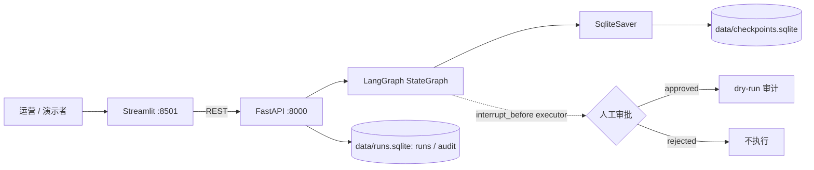

# SPEC-002 · HITL 状态跨重启持久化

- **状态**: approved
- **Approved**: yes (mike.wang.ext, 2026-11-24)
- **批准范围**: 只批准「待审批 run 跨 API 重启可恢复」这一增量；不改 `SPEC.md` 基线、不改 UI、不接真实 Amazon API。
- **关联**: `SPEC.md`（基线）、`docs/adr/ADR-002-hitl-checkpoint.md`

## 一句话

API 重启后，停在 `awaiting_approval` 的 run 仍可查询、批准或拒绝，不丢状态、不重复执行。

## 用户与场景

- **演示者**：跑完 `SKU-003` 全链路，页面停在审批闸门；此时重启 API，回来后仍能点 Approve，执行 5 条 dry-run。
- **开发者**：用「创建 → 停 API → 起 API → 查询 → 批准」做回归，确认不是只在内存里看起来能跑。

## 本期范围

- **做**：
  - 用 LangGraph 官方 `SqliteSaver` 持久化 checkpoint，落在 `data/checkpoints.sqlite`。
  - `build_graph` 支持注入 checkpointer；API 在 lifespan 里创建并关闭。
  - 配置项 `checkpoint_db_path`；依赖固定为 `langgraph-checkpoint-sqlite==3.1.3`。
  - 补 `docs/verify.md` 的重启验证段；更新 Ticket / PROGRESS。
- **不做**：HTTP 响应结构变更、UI 改版、多进程/多 worker、checkpoint 清理策略、旧 run 迁移。

## 明确不做（Non-goals）

> 必须有。没有 Non-goals，范围一定会失控。

- 不做多进程 / 多 worker / 多机部署；SQLite 单写者，只支持单 API 进程。
- 不引入 Postgres / Redis / 外部 checkpoint 服务。
- 不做 checkpoint 保留期、压缩、归档或 GC。
- 不迁移本次改动前已经在内存里的待审批 run；它们仍可从 `runs` 表读取，但不能批准。
- 不改审批语义：仍然 `interrupt_before=["executor"]`，`executor` 仍然只做 dry-run。
- 不改 Streamlit 页面；UI 技能 `unslop` 本轮不调用。
- 不做并发审批的跨进程互斥；单进程内的重复批准必须幂等，但不承诺多 worker 安全。

## 验收标准（可执行）

- [x] **AC-1 重启后仍待审批**：启动 API → `POST /runs {"sku_id":"SKU-003","mode":"full_chain"}` → `awaiting_approval`。停 API、再启动；`GET /runs/{run_id}` → `status: "awaiting_approval"`、`next: ["executor"]`，且 `state` 中 `sku_id`、`mode`、`draft_listing.title`、`ads_report.last_30d.acos` 与重启前一致。
- [x] **AC-2 重启后批准**：接 AC-1，`POST /runs/{run_id}/approve {"decision":"approved"}` → `status: "completed"`；`execution_log` 5 条且全部 `dry_run_success`；`audit` 有 1 条 `approval_decision` + 5 条 `execute_dry_run`；`runs` 表该 run 为 `completed`。
- [x] **AC-3 重启后拒绝**：新建 run → 停/起 API → `POST /approve {"decision":"rejected"}` → `status: "completed"`；`execution_log` 只有 1 条 `action: "skip"` / `status: "rejected"`，没有 `dry_run_success`；`audit` 有 `approval_decision` 与 `execute_skipped`，没有 `execute_dry_run`。
- [x] **AC-4 重复批准幂等**：AC-2 完成后停/起 API，再 `POST /approve` 一次 → 仍 `completed`；`execution_log` 仍 5 条；`audit` 中 `approval_decision` 与 `execute_dry_run` 计数不变（1 / 5）。
- [x] **AC-5 文件与忽略**：`data/checkpoints.sqlite` 被创建；`git status` 不出现该文件；`.gitignore` 的 `*.sqlite` + `*.sqlite-*` 覆盖主文件与 `-wal` / `-shm`。
- [x] **AC-6 回归**：`-m evals.run_eval` → 10/10；`-m scripts.smoke_test` → 5 条 dry-run；`AppTest` → 6 tabs、run→awaiting_approval、approve→completed；`-m scripts.run_demo --sku SKU-003 --approve` 仍可跑（默认 `MemorySaver`）。
- [x] **AC-7 依赖可安装**：`uv pip install --python .venv\Scripts\python.exe -r requirements.txt` 成功；`python -c "from langgraph.checkpoint.sqlite import SqliteSaver"` 无报错；`langgraph` 固定为 `>=1.2.24,<2`，`langgraph-checkpoint-sqlite==3.1.3`。
- [x] **AC-8 HTTP 兼容**：`/health`、`/skus`、`/runs`、`/runs/{id}`、`/approve`、`/metrics` 的响应键不变；只有「重启后能否继续」的行为变化。

## 现状地图（已有代码必填）

- **入口**：`api/main.py` 的 lifespan 启动时 `build_services()` + `build_graph(services)`，全局持有 `graph`；`scripts/run_demo.py` / `scripts/smoke_test.py` 直接 `build_graph(services)`。
- **模块**：
  - `agent/graph.py:53-56`：`builder.compile(checkpointer=MemorySaver(), interrupt_before=["executor"])`。**这就是待审批状态只存在进程内的根因。**
  - `api/main.py:20-25`：lifespan 创建 graph；`:49-58` `_snapshot` 读 `graph.get_state`；`:147-182` `approve` 做 `update_state` + `invoke(None)`；`:130-144` `GET /runs/{id}` 在内存无快照时回退 `runs` 表。
  - `core/config.py:20-26`：`Settings.db_path = data/runs.sqlite`；尚无 checkpoint 路径。
  - `core/db.py`：`runs` / `audit` 两张表；`save_run` 已保存完整 `state_json`。
  - `scripts/run_demo.py` / `scripts/smoke_test.py`：调用 `build_graph(services)`，无 checkpointer 参数。
- **数据流**：`Streamlit → FastAPI → LangGraph → nodes`；运行快照与审计写 `data/runs.sqlite`；checkpoint 目前只在 `MemorySaver` 里。
- **外部依赖**：`langgraph 1.2.24`、`langgraph-checkpoint 4.3.2`；`langgraph-checkpoint-sqlite` **未安装**。`requirements.txt` 写的是 `langgraph>=0.2.50`，与 3.x sqlite saver 不兼容，需要收紧。
- **不能碰的边界**：
  - HTTP 响应键（Streamlit 依赖）。
  - `interrupt_before=["executor"]` 与 dry-run 语义。
  - `data/seed/**` 只读。
  - `runs` / `audit` 表结构：本期不改；checkpoint 用独立库，避免与业务表混用。

## 设计（复杂度超过阈值时必填）

> 阈值命中：改数据模型 / 多模块 / 外部依赖。

### 方案对比

| 方案 | 做法 | 优点 | 代价 | 结论 |
|---|---|---|---|---|
| A 官方 `SqliteSaver` | 新增 `langgraph-checkpoint-sqlite`，checkpoint 落独立 SQLite | 官方维护、schema 与 LangGraph 版本同步、改动小 | 新增 1 个直接依赖 + `aiosqlite` / `sqlite-vec` 传递依赖；需收紧 `langgraph` | **采用** |
| B 自写 `BaseCheckpointSaver` | 自己实现 SQLite 表与序列化 | 不新增依赖 | 必须追 LangGraph 内部 checkpoint schema、writes、版本迁移；风险高 | 拒绝 |
| C 从 `runs.state_json` 重建 | 用 `graph.update_state(as_node=...)` 把旧状态灌回内存图 | 不新增依赖 | 依赖 `as_node` 与 interrupt 的隐含语义；不同 mode 的前驱不同；可能跳过或重复执行 executor | 拒绝 |
| D Postgres / Redis | 外部 checkpoint 服务 | 多 worker | 对 demo 过重，增加运维与密钥 | 拒绝 |

### 模块 / 数据流图



### 实现草图（批准后照此落地）

```python
# core/config.py
checkpoint_db_path: Path = ROOT / "data" / "checkpoints.sqlite"

# agent/graph.py
from langgraph.checkpoint.base import BaseCheckpointSaver

def build_graph(services: Services, checkpointer: BaseCheckpointSaver | None = None):
    ...
    return builder.compile(
        checkpointer=checkpointer or MemorySaver(),
        interrupt_before=["executor"],
    )

# api/main.py lifespan
from langgraph.checkpoint.sqlite import SqliteSaver

with SqliteSaver.from_conn_string(str(settings.checkpoint_db_path)) as checkpointer:
    graph = build_graph(services, checkpointer)
    yield
```

`SqliteSaver.from_conn_string` 内部使用 `check_same_thread=False` 并自带锁；首次使用时自动建表并启用 WAL。CLI / 冒烟不传 checkpointer，继续用 `MemorySaver`，避免测试互相污染。

### UI 线框 / 路由（有 UI 时）

- **UI 技能**：`unslop`（只此一个；本轮无 UI 改动，不调用、不安装）。
- **页面 / 路由**：无变化；Streamlit 仍为单页 6 tab。
- **关键状态**：重启后侧栏仍显示 `awaiting_approval` 与 Approve / Reject；若 Streamlit 会话里的旧 snapshot 过期，用户重新 Run 或刷新即可。
- **明确不做（anti-slop）**：不加「已恢复」之类的装饰性动画或假状态。

### 接口契约

- **外部 HTTP**：路径、请求体、响应键全部不变。行为变化只有：
  - `GET /runs/{id}` 在 API 重启后可从 checkpoint 返回 `state` 与 `next`；
  - `POST /approve` 在 API 重启后仍可执行，而不是 404。
- **内部模块边界**：
  - `build_graph(services, checkpointer=None)`；不传时默认 `MemorySaver`。
  - API 是唯一持有 `SqliteSaver` 生命周期的地方；node 不接触 checkpointer。
  - checkpoint 库与 `runs.sqlite` 分离，避免 LangGraph 表与业务表互相锁。
- **错误与降级**：
  - checkpoint 库打不开 → API 启动失败并报清晰错误（不静默退回 `MemorySaver`，否则会假装持久化）。
  - 旧 run 没有 checkpoint → `GET /runs/{id}` 回退 `runs` 表；`/approve` 返回 404，并在响应里说明「该 run 无 checkpoint，不能恢复」。
  - 重复批准 → 直接返回当前快照，不重复执行、不重复写 `approval_decision`。

## 技术决策

| 项 | 选择 | 理由 | 备选 / 何时重评 |
|---|---|---|---|
| checkpoint 存储 | `SqliteSaver` + `data/checkpoints.sqlite` | 官方维护，单文件零运维 | 多 worker 时重评 Postgres |
| 直接依赖 | `langgraph-checkpoint-sqlite==3.1.3` | 与 `langgraph-checkpoint 4.3.2` 兼容 | 升级 LangGraph 时同步 |
| LangGraph 版本 | `langgraph>=1.2.24,<2` | 现有 `>=0.2.50` 会解析到不兼容的旧版 | 升级前跑 AC-1..AC-8 |
| 业务库 | `runs.sqlite` 不动 | 避免 schema 耦合与锁竞争 | 需要统一事务时重评 |
| CLI / 测试 | 默认 `MemorySaver` | 不污染持久库，测试可重复 | 需要 CLI 跨重启时再改 |

## 风险与未知

- **风险 1**：新增传递依赖 `aiosqlite`、`sqlite-vec`；`sqlite-vec 0.1.9` 有 Windows `py3-none-win_amd64` wheel，但仍是新的原生扩展，需在目标机器验证安装。
- **风险 2**：SQLite 单写者；多 worker 会锁冲突。本期只支持单 API 进程。
- **风险 3**：checkpoint 库会持续增长；本期不做 GC，演示数据量可接受。
- **风险 4**：checkpoint 里含完整评论 / Listing 状态；文件在 `data/` 下，必须保持 gitignore，不能提交。
- **风险 5**：旧 run 无法批准；升级后第一次演示要用新 run。
- **风险 6**：`SqliteSaver` 的同步 API 在 FastAPI 线程池里运行；单连接共享靠内部锁，需验证并发 approve 不会死锁。
- **未知**：`langgraph-checkpoint-sqlite 3.1.3` 与 `langgraph 1.2.24` 的实际组合尚未安装验证；批准后第一件事是装依赖并跑最小持久化用例。
- **先验证什么**：AC-7（依赖可装）→ AC-1（重启后仍待审批）→ AC-2（重启后批准）→ AC-4（幂等）。

## 批准记录

- 用户明确说「开始 / 批准」的原话：「批准，开始」
- 批准时间：2026-11-24（本地）
- 批准范围：官方 `SqliteSaver` 持久化 HITL checkpoint；接受新增 `langgraph-checkpoint-sqlite==3.1.3` 及其传递依赖；不改 HTTP / UI / 审批语义。
