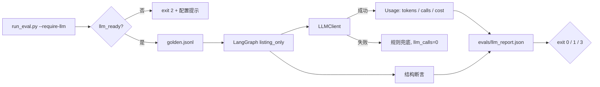

# SPEC-003 · 真实 LLM 回归

- **状态**: approved
- **Approved**: yes (mike.wang.ext, 2026-11-24)
- **批准范围**: 真实 LLM 路径的回归入口与报告；Agnes AI OpenAI 兼容接入；免费端点 429 / 临时错误的有界退避；provider token 单价与 case 间隔可配置。不改业务 prompt 语义、不放宽 golden 判定、不接 CI 密钥、不提交凭据。
- **关联**: `SPEC.md`（基线）、`SPEC-002-hitl-persistence.md`（前一个增量）、`docs/adr/ADR-003-llm-regression.md`、`T-005`

## 一句话

让评测能明确区分「真实 LLM 生成」与「规则兜底」：有 key 时跑真实调用并记录模型 / token / 成本 / 通过率；没 key 时显式失败，而不是拿兜底的 10/10 冒充 LLM 回归。

## 用户与场景

- **开发者（有 key）**：先跑 `--case G-001` 花几分钱确认连通，再跑 10 条全量，拿到真实模型的结构化通过率和成本。
- **没有 key 的机器 / CI**：默认评测仍跑兜底；只有显式 `--require-llm` 时才失败，避免误报。
- **评审者**：看 `evals/llm_report.json` 就能知道用的模型、调用次数、token、估算成本、哪些 case 失败。

## 本期范围

- **做**：
  - `evals/run_eval.py` 增加 `--require-llm`、`--case`、`--limit`、`--max-cost-usd`、`--report`。
  - `--require-llm` 在 `llm_ready=False` 时直接退出码 2，并打印配置提示。
  - 报告记录 `mode`、`model`、`llm_calls`、`tokens`、`cost_usd`、`duration_sec`、`aborted`；每个 case 记录 `llm_calls` / `tokens` / `cost_usd` / `latency_sec`。
  - 成本上限：累计估算成本超过 `--max-cost-usd` 时停止后续 case，退出码 3。
  - `docs/verify.md` 增加「LLM 回归」段；`.gitignore` 覆盖 `evals/llm_report.json`。
  - T-005 扩展：Agnes AI OpenAI 兼容端点接入；429 / 408 / 5xx 有界指数退避；`MODEL_PRICE_INPUT` / `MODEL_PRICE_OUTPUT` 覆盖刊例价；`LLM_CASE_DELAY_SEC` 控制 case 间隔。
- **不做**：prompt 调优、换 provider 抽象、CI 注入真实 key、把 LLM 回归设成每次提交的强制闸门、保存完整 prompt / 响应。

## 明确不做（Non-goals）

> 必须有。没有 Non-goals，范围一定会失控。

- 不在 CI / 默认评测中自动调用真实 LLM；必须显式 `--require-llm`。
- 不追求固定分数；真实模型输出非确定，结构性断言失败是证据，不是要「调到全绿」。
- 不做重试/退避增强的**初始版本**；T-005 因 Agnes 免费端点实际触发 429，已按本 SPEC 的批准扩展加入有界退避，属于已批准范围。
- 不改 provider 抽象、业务 prompt；模型价格表只增 provider 条目，并支持环境变量覆盖，不改变原有定价语义。
- 不保存 API key、完整 prompt、完整模型响应到报告；报告只保留结构化指标与 listing 字段。
- 不把真实 LLM 回归结果作为 HITL / 审批语义的替代验证。

## 验收标准（可执行）

- [x] **AC-1 无 key 显式失败**：`LLM_ENABLED=false` 或 key 为空时，`-m evals.run_eval --require-llm` 退出码 2，输出包含「LLM 未启用 / 需要 OPENAI_API_KEY」，且不执行任何 case；默认 `-m evals.run_eval` 仍 10/10。**2026-11-24 `scripts.verify_llm_eval`：PASS AC-1 exit code 2 / message names OPENAI_API_KEY / no cases executed / no report written。**
- [x] **AC-2 单 case 真实调用**：配置 key 后，`-m evals.run_eval --require-llm --case G-001 --max-cost-usd 0.10` 执行 1 条；报告 `mode="llm"`、`llm_calls > 0`、`tokens.total > 0`、`cost_usd > 0`，并记录 `model`。**2026-11-24 实测：`1/1 passed; llm_calls=3, tokens=4001, cost=$0.000319`。**
- [x] **AC-3 全量真实回归**：`-m evals.run_eval --require-llm --max-cost-usd 0.50` 执行 10 条；报告含每个 case 的 `llm_calls` / `tokens` / `cost_usd` / `latency_sec`；结构性检查失败时退出码 1，并在报告 `failures` 中列出原因；全部通过时退出码 0。**2026-11-24 重跑：`10/10 passed; llm_calls=30, tokens=43917, cost=$0.003788`，退出 0；此前 9/10 的 `G-008 compliance blocked` 已如实记录。**
- [x] **AC-4 成本闸门**：`--max-cost-usd 0.0001` 时，首个 case 后累计成本超限，停止后续 case，退出码 3，报告 `aborted="cost_cap"` 且 `results` 只含已执行 case。**2026-11-24 `scripts.verify_llm_eval`：PASS AC-4 cost cap aborts after first case。**
- [x] **AC-5 报告卫生**：`evals/llm_report.json` 被 gitignore；报告与 stdout 不包含 `OPENAI_API_KEY` 的值、完整 prompt 或完整响应；`git status` 不出现报告文件。**`git check-ignore -v` 命中 `.env` / `llm_report.json` / `report.json`；`git ls-files` 无报告或 key。**
- [x] **AC-6 兜底回归不退化**：默认 `-m evals.run_eval` 仍 10/10，`evals/report.json` 原有键（`cases` / `passed` / `failed` / `pass_rate` / `results`）不变；新增键只增不减。**显式 `LLM_ENABLED=false; EMBEDDING_ENABLED=false` 时 10/10、`llm_calls=0`；带 key 时默认 eval 会真实调用 LLM，已在文档说明。**
- [x] **AC-7 文档可执行**：`docs/verify.md` 的「LLM 回归」段包含：如何在不打印 key 的前提下配置、单 case 命令、全量命令、成本上限、无 key 时的预期失败、报告路径与关键字段。**见 `docs/verify.md` §3.4。**
- [x] **AC-8 失败可解释**：真实调用返回非法 JSON / 网络错误时，沿用 `LLMClient` 兜底；报告必须能看出该 case 的 `llm_calls` 为 0 或低于预期，不能静默当成 LLM 通过。**真实 429 运行输出 `llm_calls_below_expected`；`scripts.verify_llm_eval` 复核 `llm_not_used` / partial fallback。**

## 现状地图（已有代码必填）

- **入口**：`evals/run_eval.py:63-113` 读 `evals/golden.jsonl` 10 条，`build_services()` + `build_graph(services)`，逐条跑 `listing_only`，做标题长度 / 五点数量 / 必备词 / 违禁词 / 引用 / 合规检查，写 `evals/report.json`，失败退出 1。
- **LLM 客户端**：`core/llm.py:90-150`；`LLMClient.enabled = cfg.llm_ready`；未启用或调用失败时静默返回 fallback，`Usage()` 为 0。**这是「无 key 也 10/10」的根因。**
- **指标**：`agent/nodes/common.py:22-31` 累计 `llm_calls`、`tokens`、`cost_usd`、`node_times`；`agent/state.py` 的 `metrics` 随 state 返回。
- **配置**：`core/config.py` 的 `llm_ready = llm_enabled and bool(openai_api_key)`；`.env.example` 有 `OPENAI_API_KEY=` 占位；`.env` 已 gitignore。
- **当前环境**：`llm_enabled=True`、`llm_ready=False`（本机没有可用 key），因此本轮只能验证「无 key 显式失败」，真实调用需要用户自行配置 key。
- **不能碰的边界**：
  - `.env` / key：不读取、不打印、不提交。
  - 现有 `evals/report.json` 的键：只增不减。
  - `listing_only` 的图路径与结构性断言：不改业务语义。
  - 默认评测必须继续无 key 可跑（10/10 兜底）。

## 设计（复杂度超过阈值时必填）

> 阈值命中：改评测入口 / 涉及外部 API / 成本与密钥。

### 方案对比

| 方案 | 做法 | 优点 | 代价 | 结论 |
|---|---|---|---|---|
| A 扩展 `run_eval.py` | 加 `--require-llm` / `--case` / `--limit` / `--max-cost-usd` / `--report` | 单一入口、复用现有断言、改动小 | 需要小心保持默认报告兼容 | **采用** |
| B 新建 `run_llm_eval.py` | 复制评测逻辑 | 互不影响 | 断言与 golden 读取会漂移 | 拒绝 |
| C pytest 参数化 | 引入 pytest 与 fixture | 生态好 | 新增依赖、CI 配置变重 | 拒绝 |
| D 只手工跑一次 | 不写代码 | 零改动 | 不可重复、无成本记录、无回归 | 拒绝 |

### 模块 / 数据流图



### 接口契约

- **CLI**：
  ```powershell
  .\.venv\Scripts\python.exe -m evals.run_eval [--require-llm] [--case G-001] [--limit N] [--max-cost-usd 0.50] [--report PATH]
  ```
- **退出码**：
  - `0`：所选 case 全部通过；
  - `1`：有结构性失败；
  - `2`：`--require-llm` 但 `llm_ready=False`；
  - `3`：累计成本超过 `--max-cost-usd`。
- **报告**（默认 `evals/llm_report.json`；`--report` 可改）：
  ```json
  {
    "mode": "llm",
    "model": "gpt-4o-mini",
    "cases": 10,
    "passed": 8,
    "failed": 2,
    "pass_rate": 0.8,
    "llm_calls": 24,
    "tokens": {"prompt": 0, "completion": 0, "total": 0},
    "cost_usd": 0.0123,
    "duration_sec": 42.1,
    "aborted": null,
    "results": [
      {"case_id": "G-001", "llm_calls": 3, "tokens": {}, "cost_usd": 0.001, "latency_sec": 4.2, "passed": true, "failures": []}
    ]
  }
  ```
- **内部边界**：改 `evals/run_eval.py`、`core/llm.py`、`core/config.py`、新增 `core/llm_retry.py` 与文档 / ignore；不改 node、graph、API、UI 或审批语义。
- **错误与降级**：`--require-llm` 且某个 case `llm_calls=0` → 该 case 记 `llm_not_used` 失败；不静默通过。

### UI 线框 / 路由（有 UI 时）

- 无 UI 改动；`unslop` 不调用。

## 技术决策

| 项 | 选择 | 理由 | 备选 / 何时重评 |
|---|---|---|---|
| 入口 | 扩展现有 `evals/run_eval.py` | 复用断言与 golden，避免漂移 | 评测逻辑膨胀到多文件时再拆 |
| 真实调用开关 | `--require-llm` 显式开启 | 默认无 key 可跑，避免 CI 误报 | 有稳定预算后可加 `--llm` 默认 |
| 成本控制 | `--max-cost-usd` 累计闸门 | 防止误跑大模型 / 全量 | 需要精确预算时改用 provider 账单 |
| 报告 | 独立 `evals/llm_report.json` | 不污染兜底报告，便于对比 | 需要统一看板时再合并 |
| 断言 | 沿用结构性检查 | 不追求固定文案，降低 flaky | 需要质量评分时另立 SPEC |

## 风险与未知

- **风险 1**：真实模型输出非确定，结构性断言可能失败；这是回归要暴露的事实，不是要调 prompt 调到全绿。
- **风险 2**：成本不可精确预估；`--max-cost-usd` 是事后闸门，最多超出一个 case 的成本。
- **风险 3**：key 泄漏；报告与 stdout 不得打印 key，`.env` 与 `llm_report.json` 必须 gitignore。
- **风险 4**：provider 兼容性；部分 OpenAI 兼容端点不支持 embeddings，需设 `EMBEDDING_ENABLED=false`。
- **风险 5**：网络错误 / 限流会触发兜底，case 可能 `llm_calls=0`；必须显式标失败，不能当通过。
- **已知（2026-11-24）**：Agnes AI 真实全量回归当前重跑 10/10；此前同配置曾因真实模型输出 `G-008 compliance blocked` 得到 9/10，属于非确定性回归证据，未改 prompt / golden / AC。
- **先验证什么**：无 key 失败 → 单 case → 全量 → 成本闸门；全部通过后再跑确定性回归与 UI / smoke 确认非退化。

## 批准记录

- 用户明确说「开始 / 批准」的原话：「真实LLM， 我们可以暂时使用使用agnes-ai，...」；随后指示「裁判回来就提交」。
- 批准时间：2026-11-24（本地）
- 批准范围：真实 LLM 回归与 Agnes AI 接入；429 / 临时错误有界退避；provider 单价与 case 间隔配置；不改业务 prompt、不放宽 golden、不提交凭据。
- T-005 扩展说明：免费端点实际触发 429 后加入退避与节流，属于完成真实回归所必需的工程改动，已由用户「裁判回来就提交」确认提交。
