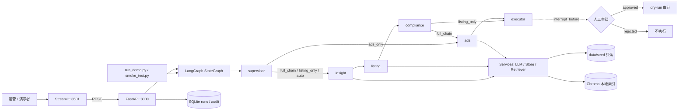

# amz-ops-agent

- **状态**: approved
- **Approved**: yes (mike.wang.ext, 2026-11-24)
- **批准范围**: 文档与工程契约回填：`AGENTS.md`、重定向文件、`PROGRESS.md`、`docs/verify.md`、Ticket 骨架、`git init` 与首次提交。**不改业务代码。**

## 一句话

给 Amazon 卖家运营演示的「多智能体运营副驾驶」：对一个 SKU 产出评论洞察、Listing 草稿、合规报告和广告调价建议，人工审批后只写 dry-run 审计。

## 用户与场景

- **谁**：面试官 / 评审、内部产品与工程同学、想评估 LangGraph + RAG + HITL 形态的卖家运营。
- **场景 1（演示）**：5 分钟内跑 `SKU-003` 全链路，展示洞察引用、草稿引用、合规修复、ACOS 诊断与审批闸门。
- **场景 2（开发）**：用 CLI、HTTP API 和 golden eval 做回归，确认改动没有破坏兜底路径和审批语义。

## 本期范围

- **做**：
  - `SPEC.md`：现状地图、范围、可执行验收标准、设计、接口契约、风险。
  - 批准后：`AGENTS.md`（≤ 40 行）、5 个重定向文件、`PROGRESS.md`、`docs/verify.md`、`.scratch/tickets/` 骨架、`git init` 与首次提交。
- **不做**：任何业务代码改动、新功能、依赖升级、真实 Amazon API、UI 改版。

## 明确不做（Non-goals）

> 必须有。没有 Non-goals，范围一定会失控。

- 不接真实 SP-API / Amazon Ads API，不写真实店铺；`executor` 永远 dry-run。
- 不做登录、多租户、权限、生产部署、告警与 SLA。**例外（2026-11-24）**：用户明确要求公开体验，允许以 Render 免费实例做演示级公开部署；仍无鉴权/限流，只使用公开评论样本（品牌匿名）与模拟广告，`executor` 只做 dry-run，不视为生产部署。
- 不做自动执行：审批闸门不可绕过。
- 不引入云向量库、消息队列、Postgres。**例外（2026-11-24）**：用户明确要求真实数据，种子改为公开 Amazon Reviews 2023（品牌匿名化）+ 模拟广告/库存/成本，见 `ADR-003`；`executor` 与审批边界不变。
- 不把本仓库包装成生产系统；README 的「演示 / dry-run」定位保持不变。
- 不在本轮做 UI 视觉改版或引入 UI 技能。

## 验收标准（可执行）

- [x] AC-1（评测闸门）：`.\.venv\Scripts\python.exe -m evals.run_eval` 输出 `10/10 passed (100.0%)` 且退出码 0。**2026-11-23 已复跑通过。**
- [x] AC-2（全链路）：`.\.venv\Scripts\python.exe -m scripts.smoke_test` 输出 JSON，`errors` 为空，`execution_actions` ≥ 1，`compliance.passed` 为 `true`。**2026-11-23 已复跑通过（5 条 dry-run 动作）。** 注意：直接跑 `python scripts\smoke_test.py` 会因 `sys.path` 不含仓库根而 `ModuleNotFoundError`，必须用 `-m`。
- [x] AC-3（API 契约）：启动 `uvicorn api.main:app` 后：
  - `GET /health` → 200，`ok: true`；**已验证**
  - `GET /skus` → 5 个 SKU；**已验证**
  - `POST /runs {"sku_id":"SKU-003","mode":"full_chain"}` → `status: "awaiting_approval"`，`next` 含 `executor`；**已验证**
  - `POST /runs/{run_id}/approve {"decision":"approved"}` → `status: "completed"`，审计表有 `approval_decision`。**已验证（5 条执行动作，合规 100 分）**
- [x] AC-4（UI 主流程）：Streamlit 在 8501 启动；选 `SKU-003` + `full_chain` 运行；6 个 tab 均渲染；侧栏 Approve 后 Audit tab 出现 dry-run 记录；API 不可达时侧栏给出错误与启动命令，不白屏。**2026-11-24 用 `streamlit.testing.v1.AppTest` 验证：6 个 tab、run→awaiting_approval、approve→completed、5 条动作、无 error。T-004 已完成中文 UI 改版，视觉验收见 `SPEC-004-ui-redesign.md` 与 `.scratch/ui/T-004/`。**
- [x] AC-5（文档契约）：`AGENTS.md` ≤ 40 行；其中每条命令实际可跑；`CLAUDE.md` / `CODEBUDDY.md` / `GEMINI.md` / `.clinerules` / `.github/copilot-instructions.md` 只含一句重定向，不复制正文。**2026-11-24 核对：`AGENTS.md` 40 行；评测 / 冒烟 / CLI / compileall / uvicorn / streamlit 均实跑；重定向文件 2–5 行。**
- [x] AC-6（验证单一来源）：`docs/verify.md` 包含 AC-1 至 AC-4 的命令、预期输出与失败处理；`AGENTS.md` 只链接它，不复述。**2026-11-24 已生成，含实测样例与 `-m` 陷阱说明。**
- [x] AC-7（仓库卫生）：`git init` 后首次提交不包含 `.env`、`.venv/`、`data/chroma/`、`data/*.sqlite`、`evals/report.json`、`__pycache__/`；`git status` 干净。**2026-11-24 核对暂存清单 64 个文件，生成物均被忽略。**

## 现状地图（已有代码必填）

- **入口**：
  - `run.ps1`：检查 `.venv` → 缺种子则生成 → `uvicorn api.main:app`（8000）+ `streamlit run app/streamlit_app.py`（8501）。
  - `scripts/run_demo.py`：CLI 全链路，支持 `--sku` / `--mode` / `--approve` / `--reject` / `--json`。
  - `scripts/smoke_test.py`：全链路冒烟，自动批准，打印紧凑 JSON；必须用 `python -m scripts.smoke_test` 运行。
  - `evals/run_eval.py`：读 `evals/golden.jsonl`，跑 `listing_only`，写 `evals/report.json`。
- **模块**：
  - `api/main.py`：FastAPI；lifespan 里装配 `Services` 与 `StateGraph`；run 快照与审批。
  - `agent/graph.py`：`StateGraph` + `MemorySaver`，`interrupt_before=["executor"]`；supervisor 路由 `ads_only`，否则进 insight；compliance 后按 `full_chain` 进 ads，否则进 executor。
  - `agent/nodes/`：`supervisor`（SKU 校验 / auto 模式选择）、`insight`（评论主题与引用）、`listing`（检索 + 草稿 + 引用校验）、`compliance`（21 条规则，block/warn，分数）、`ads`（90 天数据、异常、调价建议、30 天回测）、`executor`（仅 dry-run 审计）。
  - `agent/services.py`：`Services(cfg, llm, store, retriever)` 装配。
  - `core/`：`config`（环境变量与路径）、`db`（SQLite `runs` / `audit`）、`llm`（OpenAI 兼容 + JSON 解析 + 兜底 + 价格表）、`store`（只读种子数据）。
  - `rag/`：`ingest`（Listing / 政策 / 规则文档）、`retriever`（BM25 + Chroma + RRF，可降级）。
  - `app/streamlit_app.py`：单页演示台，侧栏运行与审批，主区 6 个 tab。
- **数据流**：
  `Streamlit → REST → FastAPI → LangGraph → nodes → Services → data/seed（只读）`；
  运行快照写 SQLite `runs`，审批与 dry-run 动作写 `audit`；Chroma 索引落在 `data/chroma/`（生成物，已忽略）。
- **外部依赖**：
  - 可选 OpenAI 兼容 LLM（`LLM_ENABLED` + `OPENAI_API_KEY`）与 embedding；关闭时走规则 / 模板兜底。
  - 无真实 Amazon API。Python 3.11.8；FastAPI、LangGraph、Streamlit、Chroma、rank-bm25 等见 `requirements.txt`。
- **不能碰的边界**：
  - `.env` 与任何密钥：不读取、不打印、不提交。
  - `data/seed/**`：只读输入；需要改数据时改 `data/generate_seed.py` 并重新生成。
  - `executor`：只能 dry-run；不得删除 `interrupt_before` 或增加真实写接口。
  - 合规规则的 `block` / `warn` 语义：改动必须同步 golden eval。
  - API 响应字段（`run_id` / `status` / `state` / `metrics` / `next`）：Streamlit 依赖，改动需同步前端。
  - `data/chroma/`、`data/runs.sqlite`、`evals/report.json`、`.venv/`：生成物，不提交。

## 设计（复杂度超过阈值时必填）

> 阈值命中：多模块 / 有 UI / 多 Agent / 有外部依赖。故必须写设计。

### 方案对比（本轮文档回填）

| 方案 | 做法 | 优点 | 代价 | 结论 |
|---|---|---|---|---|
| A 分阶段回填 | 先 SPEC → 批准 → AGENTS / verify / git | 契约先定，命令先验证，符合 Gate 0 | 需要两次交互 | **采用** |
| B 一次性全写 | 同时生成 SPEC + AGENTS + tickets + git | 快 | AGENTS 可能写错命令与范围，无法先确认 | 拒绝 |
| C 只写 AGENTS 一页 | 只补一页规则 | 最轻 | 无现状地图、无 AC、无验证锚点，必然漂移 | 拒绝 |

### 模块 / 数据流图

### UI 线框 / 路由（有 UI 时）

- **UI 技能**：`unslop`（已安装到 `.claude/skills/unslop`，CC BY 4.0；中文改版见 `SPEC-004-ui-redesign.md`。选它是因为它能吃 URL / 截图，适合 Streamlit 生成式 DOM；`impeccable` 的 62 条规则面向手写前端，命中率低）。
- **设计方向**：纸白 / 墨色 / 黄铜的运营台账；首屏最显眼的是人工闸门 `等待审批 → 已完成` 的状态变化（详见 `SPEC-004`）。
- **设计 token**：见 `SPEC-004` 的颜色、字体、4px 网格与对比度约束。
- **页面 / 路由**：单页 Streamlit；侧栏 = 连接 / 运行 / 审批闸门；主区 = 洞察、Listing、合规、广告、审计、指标六个 tab。
- **主流程**：选 SKU → 选 mode → Run → 依次看洞察 / 草稿 / 合规 / 广告 → 侧栏 Approve 或 Reject → 看 Audit / Metrics。
- **关键状态**：
  - 空：未运行时给出「选 SKU 并 Run」的说明与 5 步流程。
  - 加载：`spinner`，提示 LLM 下可能 30–60s。
  - 失败：API 不可达时侧栏 `st.error` + 启动命令；不白屏。
  - 成功 / 待审批：状态指标 + HITL 闸门按钮；拒绝时不产生执行记录。
  - LLM 关闭：规则兜底正常出结果，不报错。
- **明确不做（anti-slop）**：不加紫渐变、发光、玻璃拟态、emoji 图标堆砌、假实时动画；所有图表必须来自真实 run 数据，不用装饰性假数据。

### 接口契约

- **外部 API**：
  | 方法 | 路径 | 请求 | 成功响应 |
  |---|---|---|---|
  | GET | `/health` | — | `{ok, llm_enabled, vector_index}` |
  | GET | `/skus` | — | `[{sku_id, title, subcategory, price, rating, review_count}]` |
  | POST | `/runs` | `{sku_id?, mode?, request?}` | `{run_id, next, status, state, metrics}` |
  | GET | `/runs/{run_id}` | — | 同上；内存无快照时回退 SQLite |
  | POST | `/runs/{run_id}/approve` | `{decision, actor?, note?}` | 同上；非 pending 时原样返回 |
  | GET | `/runs?limit=20` | — | SQLite 运行列表 |
  | GET | `/metrics` | — | 聚合指标 |
- **内部模块边界**：
  - node 只读写 `AgentState`，不直接碰 FastAPI / Streamlit。
  - `Services` 是 LLM / Store / Retriever 的唯一装配点；node 不自行构造客户端。
  - 所有持久化经 `core/db.py`；node 不直接写 SQLite。
- **错误与降级**：
  - 非法 mode → 400；未知 SKU → 404；图执行异常 → 500。
  - LLM 关闭 / 失败 → 规则兜底，`llm_calls` 为 0，不抛错。
  - 检索无 Chroma → BM25 降级；无命中 → 历史 Listing 放宽子类目再查。
  - 进程重启后 `MemorySaver` 丢失待审批状态：`GET /runs/{id}` 可读 SQLite，但 `/approve` 返回 404。**已知限制，本轮不修。**

## 技术决策

| 项 | 选择 | 理由 | 备选 / 何时重评 |
|---|---|---|---|
| 语言 / 运行时 | Python 3.11.8 | 现有代码与依赖 | 无 |
| 框架 | FastAPI + LangGraph + Streamlit | 演示形态：API 可测、图可中断、UI 快 | 换前端时重评 |
| 数据存储 | SQLite + 本地 Chroma + 种子文件 | 零运维、可复现 | 多用户 / 并发时重评 |
| LLM | OpenAI 兼容，可关闭 | 无 key 也能演示与评测 | 换供应商时只改 `core/llm.py` |
| 执行 | dry-run + HITL | 演示安全边界 | 接真实 API 前必须重做审批与幂等 |

## 风险与未知

- **风险 1**：`MemorySaver` 进程内保存待审批状态，API 重启后无法批准；演示可接受，真实使用是硬伤。
- **风险 2**：LLM 关闭时的 10/10 只证明兜底路径；真实 LLM 生成路径未验证，评测分数会变。
- **风险 3**：真实评论来自公开数据集（截至 2023），广告与弹性假设仍是模拟；文档必须持续标注「广告为模拟、回测是估算，不是线上实测」。
- **风险 4**：`_snapshot` 只要 `next` 为空就返回 `completed`，即使 `errors` 非空；状态语义偏乐观。
- **风险 5**：无鉴权、无速率限制、无并发控制；不得暴露到公网。**例外**：用户明确要求公开体验，Render 演示部署按无鉴权公开服务运行；任何人可创建 run，填入真实 LLM key 时会产生配额消耗，部署前需接受该风险。
- **风险 6**：Streamlit 1.67 对 `use_container_width` 发出弃用警告（提示 2025-12-31 后移除，当前仍可用）；升级前需替换为 `width="stretch"` / `width="content"`。已建 T-001。
- **未知**：本机 `.env` 是否启用 LLM / embedding（未读取，避免接触密钥）；真实 LLM 路径的耗时与成本。
- **先验证什么**：AC-1 至 AC-4 已验证；提交前核对 AC-5 / AC-6 / AC-7（文档行数、重定向、暂存清单）。

## 批准记录

- 用户明确说「开始 / 批准」的原话：「批准，开始」
- 批准时间：2026-11-24（本地）
- 批准范围：文档与工程契约回填；不改业务代码。
